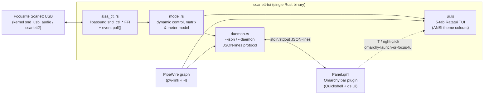

# scarlett-tui

[](https://github.com/kinggs/scarlett-tui/actions/workflows/ci.yml)
[](LICENSE)

A keyboard-first terminal mixer, routing matrix, live hardware level meter, and
[Omarchy](https://omarchy.org) bar plugin for **Focusrite Scarlett** USB audio
interfaces on Linux — written in Rust, talking straight to the mainline Linux
kernel's `scarlett2` / FCP ALSA driver through `libasound`.

One compiled binary powers both the standalone Ratatui TUI and the Omarchy bar
panel. No background daemon when unused, no Electron or GTK toolkit, no `sudo`,
and no hardcoded ALSA `numid`s.

## Why this exists

The mainline Linux kernel already exposes everything inside modern Focusrite
Scarlett interfaces — input switches, 48V phantom power, output volumes and
mutes, the internal routing patchbay, the `Mix A–F` mixer matrix, and real-time
12-bit hardware level meters.

The reference GUI (`alsa-scarlett-gui`) is great, and `alsamixer` works in a
pinch, but if you live in the terminal (and on an Omarchy desktop) there was no
dedicated TUI that shows the routing matrix, mix faders, live meters, and active
PipeWire software links together in one place.

## Status and hardware support

Controls, routing tables, mix matrix dimensions, and level-meter mappings are
discovered dynamically from `libasound` (`snd_ctl_*`), so the same binary adapts
across Focusrite sizes and generations.

| Model family | Linux driver | Status |
|---|---|---|
| **Scarlett 4i4 (3rd Gen)** (`1235:8212`, fw `1605`) | `scarlett2` | **Verified on hardware** — all 5 tabs, live 18-channel meters, 6×8 matrix, Omarchy bar plugin |
| **Scarlett Gen 2** (`6i6`, `18i8`, `18i20`) | `scarlett2` | ⚠ Supported dynamically by control discovery; not yet verified on physical hardware |
| **Scarlett Gen 3** (`Solo`, `2i2`, `8i6`, `18i8`, `18i20`) | `scarlett2` | ⚠ Supported dynamically (`Direct Monitor` / matrix); not yet verified on physical hardware |
| **Scarlett Gen 4** (`Solo`, `2i2`, `4i4`) | `scarlett2` | ⚠ Digital `Gain`, 3-state `Air` enum, `Clip Safe`, `Link`, and `Direct Monitor` covered by unit tests; not yet verified on physical hardware |
| **Scarlett Gen 4 large** (`16i16`, `18i16`, `18i20`) | `fcp` | ⚠ Short FCP routing names (`Analogue 1`, `Mixer 1`) covered by unit tests; not yet verified on physical hardware |
| **Clarett USB / Clarett+ / Vocaster** | `scarlett2` | ⚠ Detected (`1235:*`) and parsed dynamically; not yet verified on physical hardware |

Have one of the ⚠ models? Open a [Device support](https://github.com/kinggs/scarlett-tui/issues/new?template=device-support.yml)
issue with the output of `scarlett-tui --json` (it contains no serial numbers or
personal paths).

### What this does today

- **Tab 1 — Overview & Meters:** real-time 12-bit hardware `Level Meter` bars
  with peak hold and dBFS readouts (mapped in `scarlett2_ports` destination
  order), input badges, output signal paths, clock sync, firmware, active sample
  rate, and active PipeWire Scarlett links.
- **Tab 2 — I/O & Device:** `Line/Inst`, `Air` (handles both Gen 3 boolean
  switches and Gen 4 3-state enums), `Pad`, `48V` phantom power, `Remember 48V`,
  digital `Gain` / `Clip Safe` / `Link` (where present), `Line 01..NN` hardware
  volumes & mutes, `Direct Monitor`, and `Standalone` switches.
- **Tab 3 — Routing:** full hardware router for `Analogue Outputs`, `S/PDIF`,
  `ADAT`, `Mixer Inputs`, `DSP Inputs`, and `PC Capture (Rec)`, showing resolved
  signal chains (e.g. `Mix A ← PCM 1 + Analogue 2 (-6.0 dB)`).
- **Tab 4 — Mix Matrix:** dynamic 2D dB grid (`Mix A..Z × In 01..NN`), with `*`
  marking mixes currently routed to an output.
- **Tab 5 — PipeWire Links:** live `pw-link` view filtered to Scarlett nodes
  first (toggle `a` for all nodes) so software loopbacks stand out beside
  hardware routing, with `d` to disconnect.
- **Omarchy bar plugin (`io.github.kinggs.scarlett-tui`):** compact bar widget
  inspired by Omarchy's built-in `omarchy.audio` panel — live dB meters while
  open, input chips, `48V` switches, clickable output routing rows, and one
  click / `T` / right-click to launch `scarlett-tui` in a floating terminal
  (`TUI.float`).

### What this does not do (yet)

- **No firmware flashing** (use Geoffrey Bennett's [`scarlett2`](https://github.com/geoffreybennett/scarlett2) CLI for that).
- **No preset save/load yet** inside the TUI (`alsactl store` / `restore` works alongside it).
- **No PipeWire sample-rate / quantum switching** (intentionally focused on the hardware interface and routing visibility; PipeWire clock stays under PipeWire/WirePlumber).

## What it is not

- **Not affiliated with or endorsed by Focusrite Audio Engineering Ltd.**
  Focusrite, Scarlett, Clarett, and Vocaster are trademarks of Focusrite Audio
  Engineering Ltd., used here only to identify supported hardware.
- **No proprietary firmware, drivers, or assets** are included in this repository.
- **No privilege escalation:** `scarlett-tui` never runs `sudo` or `pkexec`,
  never installs system packages, and never writes under `/etc` or
  `~/.config/pipewire`.

## How it fits together



## Requirements

- **Linux kernel 6.7+** (mainline `snd_usb_audio` enables the `scarlett2` mixer
  driver automatically without module options; older kernels require
  `options snd_usb_audio vid=0x1235 pid=0x<pid> device_setup=1`).
- **Runtime:** `alsa-lib` (`libasound.so.2`). Optional: `pipewire` (`pw-link`)
  for Tab 5; Omarchy 4 + Quickshell if using the bar plugin.
- **Build:** Rust `1.100.0` (pinned in `rust-toolchain.toml` and `mise.toml`),
  `alsa-lib` headers, and a C linker.

## Install

### Standalone TUI (any Linux distro)

```sh
git clone https://github.com/kinggs/scarlett-tui.git
cd scarlett-tui
mise install      # optional: installs the pinned Rust 1.100.0
make install      # builds release binary -> ~/.local/bin/scarlett-tui + desktop entry
```

Run it in any terminal with:

```sh
scarlett-tui
```

The TUI uses standard ANSI terminal colours, so it inherits your terminal
(and Omarchy) theme automatically.

### With the Omarchy bar plugin

```sh
git clone https://github.com/kinggs/scarlett-tui.git
cd scarlett-tui
make install-plugin
```

This builds and installs `~/.local/bin/scarlett-tui`, validates `manifest.json`
and `Panel.qml`, links the repository into
`~/.config/omarchy/plugins/io.github.kinggs.scarlett-tui`, and enables the bar
widget on the right section of the Omarchy bar.

*(If you added the repository via `omarchy plugin add https://github.com/kinggs/scarlett-tui.git`,
run `cd ~/.config/omarchy/plugins/io.github.kinggs.scarlett-tui && make install`
once to build the Rust binary.)*

### Remove

```sh
cd /path/to/scarlett-tui
make uninstall
```

Or manually:

```sh
omarchy plugin disable io.github.kinggs.scarlett-tui
rm -f ~/.config/omarchy/plugins/io.github.kinggs.scarlett-tui \
      ~/.local/bin/scarlett-tui \
      "$HOME/.local/share/applications/Scarlett TUI.desktop"
```

Hardware settings live on the Scarlett itself (and ALSA's `alsa-restore.service`
if enabled); uninstalling removes no system configs or saved audio state.

## Keybindings

| Key | Action |
|---|---|
| `1`–`5` / `Tab` / `Shift+Tab` | Switch tabs |
| `h`/`j`/`k`/`l` or arrows | Move cursor / adjust values |
| `Enter` / `Space` | Toggle switch, open route picker, or mute/unmute matrix cell |
| `+` / `-` or `]` / `[` | Adjust level ±1 dB (Mix Matrix) |
| `}` / `{` | Adjust level ±6 dB (Mix Matrix) |
| `0` | Snap level to `0.0 dB` unity (or route to `Off` on Routing tab) |
| `m` / `x` | Mute / toggle cell (or `Off` on Routing tab) |
| `a` / `d` | Show all PipeWire links / disconnect selected link (Tab 5) |
| `c` | Switch card (when multiple Focusrite interfaces are connected) |
| `r` | Rescan ALSA & PipeWire state |
| `q` / `Ctrl+C` | Quit |

### CLI modes

```sh
scarlett-tui [--card N]           # Interactive TUI
scarlett-tui --list               # List detected Focusrite USB cards
scarlett-tui --json [--card N]    # Print current state snapshot as JSON
scarlett-tui --daemon [--card N]  # Event-driven JSON-lines daemon (used by Panel.qml)
```

## Build, test, and lint

```sh
make test    # toolchain pin check, plugin & QML UI-safety check, cargo test
make lint    # cargo fmt --check, cargo clippy -D warnings, plugin check
make build   # release binary (target/release/scarlett-tui)
```

## Why MIT

Anyone — including other Omarchy plugin authors, Linux audio maintainers, or
Focusrite — should be able to reuse any part of this without licensing friction.
All `libasound` calls use the public C ABI dynamically linked at runtime; no GPL
driver or GUI source code is copied into this repository.

## Contributing

Contributions from people and coding agents are welcome under the same rules.
Read [CONTRIBUTING.md](CONTRIBUTING.md) and [AGENTS.md](AGENTS.md) before
starting.

## Licence

[MIT](LICENSE). Copyright (c) 2026 Kenny Inggs and the scarlett-tui
contributors. Third-party credits and licences are listed in
[CREDITS.md](CREDITS.md).
